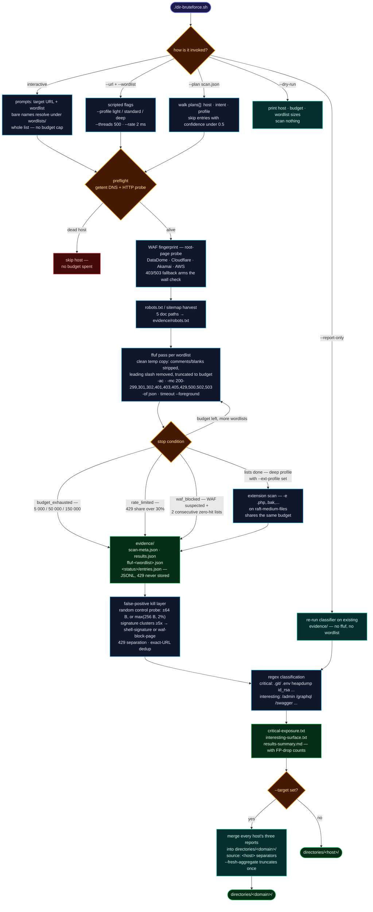

<h1 align="center">
  <br>
  
  <br>
  swarmrecon
  <br>
</h1>

<h4 align="center">Single-command web recon — CT · DNS · nmap · bruteforce · vhosts · crawling · filtering — in one 14-step script</h4>

<p align="center">
  
  
  
  
  
  /">
</p>

<p align="center">
  <b>swarmrecon</b> runs your entire recon playbook as one command —
  <code>./swarmrecon.sh -d target.com</code> — across <b>14 steps</b> and <b>20+ tools</b>,
  writing everything into a fixed <code>recon/&lt;domain&gt;/</code> tree:
  per-step raw output plus <b>final consumable files at the root</b>
  (<code>https-subs.txt</code> · <code>alive-domains.txt</code> · <code>merged-crawl.txt</code> ·
  <code>check/param-urls.txt</code> · <code>check/gf/gf-*.txt</code>)
  ready to feed into further testing or an engagement pipeline.
  <b>Fail-soft</b> — a missing tool skips its step with a warning, never aborts the run.
</p>

---

**Quick links:** [What is this?](#what-is-this) · [Quick Install](#quick-install) · [Usage](#usage) · [Pipeline](#pipeline-14-steps) · [Port discovery → brute-force](#port-discovery--service-brute-forcing-manual) · [Directory bruteforce](#directory-bruteforce-manual) · [Engagement Flow](#engagement-flow) · [Wordlists & patterns](#wordlists--patterns) · [Design notes](#design-notes)

---

## What is this?

Recon normally means hand-running ~30 commands across CT logs, DNS, port scans,
bruteforce, crawling, and filtering — then manually sorting outputs into a folder
structure. `swarmrecon.sh` encodes that whole playbook:

- **One command** runs the full chain end to end.
- **Fail-soft by design** — a missing tool or failed step produces a warning and a
  `skip`/`fail` row in the final summary; the script exits `0` with a summary table
  (`✓` ok / `−` skipped / `✗` failed) instead of dying halfway. Most tool output
  is appended to `recon/<domain>/recon.log`; some tools write directly to their
  step files (see the per-step notes below).
- **Deterministic layout** — same folders, same filenames, every run. Steps that
  feed later stages clear their previous results before use, so a failed rerun
  cannot feed stale data downstream; a skipped step may still leave old raw
  evidence in its own folder.
- **Wordlists ship with the repo** — no separate download step.

---

## Quick Install

```bash
# 1. Clone & enter
git clone https://github.com/manojxshrestha/swarmrecon.git && cd swarmrecon

# 2. Install deps (wappalyzer + chromium, ctfr, unfurl, puredns + massdns,
#    subenum, GF patterns; plus intel/OSINT tools via uv — msftrecon ·
#    Scopify · Spoofy · cloud_enum · theHarvester)
./install.sh
```

> **Idempotent — safe to re-run**: `install.sh` checks every component first and
> **skips what's already installed** (only missing things are installed); the GF
> sync likewise skips patterns already present and identical in `~/.gf`.
> It covers `wappalyzer`, Playwright Chromium, `ctfr` (→ `~/ctfr`, own venv),
> `puredns` + `massdns` (→ Go bin + `/usr/local/bin`), `subenum` (→ `~/subenum`,
> runs its own `install.sh`), and **GF patterns** (`./sync-gf-patterns.sh` copies
> `gf-patterns/*.json` → `~/.gf`, skips the manifest, prunes stale files).
> With `uv` present it also sets up the step-3/4 intel tools — `msftrecon`,
> `Scopify`, `Spoofy`, `cloud_enum` (→ `~/.local/bin/<repo>`, own venv) and
> `theHarvester` (→ `~/theHarvester`); without `uv` they're skipped with a hint.
> Everything else must already be on your `PATH`
> (see [Prerequisites](#prerequisites)). Wordlists are bundled in `wordlists/`.

---

## Prerequisites

External tools the script drives (install anything missing — `./install.sh`
handles its own set; any tool absent → that step skips itself with a hint and
the run continues):

| Category | Tools |
|----------|-------|
| Core | `bash` (5.x), `curl`, `jq`, `python3`, `git` |
| DNS | `dig`, `nslookup`, `whois` |
| Scanning / fuzzing | `nmap`, `ffuf` |
| ProjectDiscovery | `httpx`, `dnsx` |
| URL discovery | `gau`, `anew`, `uro`, `hakrawler`, `katana`, `gospider` |
| Classification | `gf` — patterns **bundled** in `gf-patterns/` (125 patterns, synced to `~/.gf` by `./install.sh`) |
| Crawling | `waymore` — manual venv: `python3 -m venv ~/waymore/venv && ~/waymore/venv/bin/pip install waymore` (step 13 activates `~/waymore/venv`) |
| Intel / OSINT (steps 3-4) | `theHarvester`, `msftrecon`, `Scopify`, `Spoofy`, `cloud_enum` — set up by `./install.sh` via `uv` |

---

## Usage

```bash
./swarmrecon.sh -d target.com
```

| Flag | Meaning |
|------|---------|
| `-d <domain>` | target domain (required) |
| `-h` | usage |

Notes:

- Run it **from the repo directory** — outputs land in `recon/<domain>/` relative
  to your current working directory.
- Every run truncates and rewrites `recon/<domain>/recon.log`.
- Colours auto-disable when output is piped or when `NO_COLOR` is set.
- **Step 11 (directory bruteforce) is manual** — the pipeline records a *skip*
  row and prints a pointer; run `./dir-bruteforce.sh` yourself when you want
  path discovery (see [Directory Bruteforce](#directory-bruteforce-manual)).

---

## Pipeline (14 steps)

| # | Step | Tool(s) | Output |
|---|------|---------|--------|
| 1 | Technology discovery | `wappalyzer` (Playwright/Chromium) | `01-wappalyzer/technologies.json` |
| 2 | DNS + WHOIS | `dig`, `whois`, `nslookup` | `02-dns-whois/` — 13 files: A/AAAA/NS/MX/TXT/CAA/SOA/DMARC, Google/Cloudflare resolvers, nslookup, whois per domain + per resolved IP |
| 3 | Passive intel | `whois` + `msftrecon`, `Scopify`, `Spoofy`, `cloud_enum` (auto-venv) | `03-intel/` — `domain_info_general.txt`, `azure_tenant_domains.txt`, `scopify.txt`, `spoof.txt`, `cloud_enum.txt` |
| 4 | OSINT — subdomains + emails | `theHarvester` (2 source sets) | `04-osint/` — `theharvester_subdomains.json`, `theharvester_emails.json`, `subdomains.txt`, `emails.txt` |
| 5 | Port scan (single pass) | `nmap` | `05-nmap/` — `nmap-full.txt` (`-Pn --open -sV -T4 --top-ports 1000 --min-rate 500`) |
| 6 | Certificate Transparency | `ctfr` (auto-venv) + `httpx` | `06-ctfr/` — `ctfr-subdomains.txt`, `live-ctfr-subdomains.txt` (live-probed) |
| 7 | Subdomain enumeration | `subenum` + CT merge | root **`https-subs.txt`**, **`alive-domains.txt`** |
| 8 | DNS bruteforce | `puredns` + `massdns` | `08-puredns/puredns-subdomains.txt` |
| 9 | Vhost fuzzing | `ffuf` (2 passes vs. dynamic baseline) | `09-vhost/` — `vhost-baseline.txt`, `vhost-mc-all.json`, `vhost-no403.json` |
| 10 | Zone transfer (AXFR) | `nslookup`, `dig axfr` per NS | `10-zone-transfer/` — `nslookup-NS.txt`, `axfr-<ns>.txt` |
| 11 | Directory bruteforce | *manual* | not automated — run `./dir-bruteforce.sh` (interactive prompts: target URL → wordlist path) → `directories/<host>/` |
| 12 | Public files | `curl` | `12-robots-sitemap/` — `robots.txt`, `security.txt`, 7 sitemap path variants |
| 13 | Web crawling (10 sub-steps) | `waymore`, `gau`, `uro`, `anew`, `hakrawler`, `katana`, `gospider`, `dnsx`, `httpx`, `extracturls.sh`, `filter.sh`, `gf` | root crawl files + `gooutput/` + `check/` (+ `check/gf/`) |
| 14 | High-value paths | `ffuf` (auto-calibrated) — sources: `https://<domain>` + each host in `alive-domains.txt` | `14-high-value/` — `high-value-results.json` (merged), `high-value-results.txt`, `high-value-<host>.json` |

> **After step 5:** an optional manual extension — masscan → nmap `-sV` →
> brutespray, see [Port Discovery & Service Brute-Forcing](#port-discovery--service-brute-forcing-manual)
> (not automated: an explicit credential-guessing decision).

> **Step 11 is manual** — `swarmrecon.sh` only records a *skip* row; directory
> bruteforce runs when you invoke `./dir-bruteforce.sh` yourself.
> Full guide: [Directory Bruteforce (manual)](#directory-bruteforce-manual).

### Step 13 in detail

1. `cd ~/waymore && waymore -i <domain> -mode U -oU wayurls.txt` (venv activated, runs inside `~/waymore`, stale `wayurls.txt` removed first) → **moved** to root `wayurls.txt`
2. `echo <domain> | gau --threads 10 --subs | anew gauurls.txt` (no `anew` → plain `> gauurls.txt`) → root `gauurls.txt`
3. `cat wayurls.txt gauurls.txt | uro | sort -u > waygauurls.txt` (only the inputs that exist; no `uro` → `sort -u` alone) → root `waygauurls.txt`
4. `cat https-subs.txt | hakrawler -subs -u -d 3 > hakcrawlurls.txt` → root `hakcrawlurls.txt`
5. `cat https-subs.txt | katana -d 3 -jc -timeout 15 -c 20 | anew cleansubskatanaurls.txt` (no `anew` → plain `> cleansubskatanaurls.txt`) → root `cleansubskatanaurls.txt`
6. `gospider -S https-subs.txt -o gooutput/ -c 10 -d 3 -t 20` → `gooutput/`
7. `extracturls.sh -f gooutput/ -d <domain>` (requires `dnsx` + `httpx`) → writes into `gooutput/`, then `alivesubsurls.txt` is **moved** to root
8. `cat waygauurls.txt cleansubskatanaurls.txt hakcrawlurls.txt alivesubsurls.txt | uro > merged-crawl.txt` (missing inputs skipped with a warning; no `uro` → `sort -u`) → root **`merged-crawl.txt`**
9. `cd recon/<domain> && echo <domain> | filter.sh` (liveness + param/API/IDOR classification; cwd must be the recon dir so its default input `merged-crawl.txt` resolves) → `check/`
10. `cd recon/<domain> && gf-extract.sh check/param-urls.txt check/gf` → `check/gf/gf-*.txt`

---

## Port Discovery & Service Brute-Forcing (manual)

Optional workflow that extends **step 5** — it covers the complete pipeline from
fast port discovery to service-aware credential guessing using
**masscan / dnmasscan → nmap → brutespray**:

```mermaid
flowchart LR
    classDef entry fill:#1e1b4b,stroke:#818cf8,stroke-width:2px,color:#e0e7ff
    classDef phase fill:#0f172a,stroke:#38bdf8,stroke-width:1.5px,color:#e2e8f0
    classDef decision fill:#451a03,stroke:#f59e0b,stroke-width:2px,color:#fde68a
    classDef manual fill:#042f2e,stroke:#2dd4bf,stroke-width:1.5px,color:#ccfbf1
    classDef artifact fill:#052e16,stroke:#4ade80,stroke-width:1.5px,color:#dcfce7
    classDef halt fill:#450a0a,stroke:#f87171,stroke-width:1.5px,color:#fecaca

    IP["raw IP list<br/>$ipFile"]:::entry
    DOM["alive-domains.txt<br/>step 7 final"]:::entry

    IP -->|"masscan<br/>-p1-65535 · --max-rate · -oG"| MS["masscan.log<br/>grepable IP:port/open"]:::artifact
    DOM -->|"dnmasscan<br/>resolve, then --top-ports -oG"| DN["dns.log + masscan.log<br/>domains → IPs → ports"]:::artifact

    MS --> XIP["unique IPs —<br/>Host: lines, deduped"]:::phase
    DN --> XIP
    MS --> XPT["unique open ports —<br/>/open matches, deduped"]:::phase
    DN --> XPT

    XIP --> NM["nmap -sV<br/>-iL ips -p ports -oG"]:::phase
    XPT --> NM
    NM --> GN["nmap-scan.gnmap<br/>22/open/tcp//ssh/OpenSSH 8.2p1/<br/>service names resolved"]:::artifact

    GN --> AUTH{"credential testing<br/>authorized?"}:::decision
    AUTH -->|"yes — deliberate decision"| BS["brutespray -f (medusa)<br/>SSH · FTP · MySQL · RDP ..."]:::manual
    AUTH -->|"no"| HOLD["stop at inventory —<br/>ports + services only"]:::halt
    BS --> RES["scan-results/<br/>SecLists default-credentials<br/>+ custom wordlists"]:::artifact

    NOTE["not automated in swarmrecon.sh —<br/>sudo + explicit authorization"]:::halt
    GN -.-> NOTE
```



> **Not automated in `swarmrecon.sh`** — launching credential guessing must
> always be a deliberate, authorized decision. Follow the steps below.

### 1. Port Analysis with Masscan

```bash
masscan -p1-65535 -iL $ipFile --max-rate 1800 -oG $outPutFile.log
```

| Option | Purpose |
|--------|---------|
| `-p1-65535` | Scan all TCP ports |
| `-iL $ipFile` | Read target IPs from a file |
| `--max-rate` | Packets per second (adjust to your network) |
| `-oG` | Output in grepable format (compatible with Nmap) |

### 2. Port Analysis with DNMasscan

dnmasscan resolves domain names to IP addresses before scanning, then runs
Masscan. This is useful when you have a list of domains instead of raw IPs.

**Install Masscan (if not already)**

```bash
sudo apt-get --assume-yes install git make gcc
git clone https://github.com/robertdavidgraham/masscan
cd masscan
sudo make install
```

**Download DNMasscan script**

```bash
wget https://raw.githubusercontent.com/rastating/dnmasscan/refs/heads/master/dnmasscan
chmod +x dnmasscan
```

**Run DNMasscan**

```bash
sudo ./dnmasscan alive-domains.txt dns.log --top-ports 1000 -oG masscan.log
```

(`dns.log` = resolution output, `masscan.log` = grepable port results.)

### 3. Service Scanning (Bridge to BruteSpray)

Masscan only reports open ports. It does not identify the running service
(e.g. SSH vs. a custom service on port 2222). BruteSpray requires **service
names** to choose the correct brute-forcing module.

Therefore you must feed the discovered open ports to Nmap with service version
detection (`-sV`). Extract IPs and ports from Masscan output, then run targeted
Nmap:

```bash
nmap -sV -iL <(grep -oP 'Host: \K[0-9.]+' masscan.log | sort -u) -p$(grep -oP '\d+(?=/open)' masscan.log | sort -u | paste -sd,) -oG nmap-scan.gnmap
```

**Breakdown:**

| Part | What it does |
|------|--------------|
| `grep -oP 'Host: \K[0-9.]+' masscan.log \| sort -u` | Extract unique IP addresses from masscan.log |
| `grep -oP '\d+(?=/open)' masscan.log \| sort -u \| paste -sd,` | Extract unique open port numbers and join with commas |
| `nmap -sV -iL <(...) -p<ports> -oG nmap-scan.gnmap` | Run Nmap service scan only on those IPs and ports, output in grepable format |

Now `nmap-scan.gnmap` contains lines like:

```
Host: 192.168.1.10 Ports: 22/open/tcp//ssh/OpenSSH 8.2p1/, 3306/open/tcp//mysql/MySQL 5.7/
```

BruteSpray can parse this reliably.

### 4. Default Password Scanning with BruteSpray

**Login Pages**

There are three things you need to have if you want to launch a brute force
attack. The three things you need are an **endpoint with a login page, a
username, and a password.**

First, you need to find the endpoint you want to target — here BruteSpray finds
the login services from the Nmap output:

**Default Credentials:** https://github.com/danielmiessler/SecLists/tree/master/Passwords/Default-Credentials

BruteSpray reads the Nmap grepable file and launches Medusa against each
discovered login service (SSH, FTP, MySQL, RDP, etc.) using default or custom
wordlists.

```bash
# install
go install github.com/x90skysn3k/brutespray/v2@latest

brutespray -f nmap-scan.gnmap

# Use the -o flag to set a custom path
brutespray -f nmap-scan.gnmap -o scan-results
```

⚠️ Only against systems you own or have **explicit authorization** to test.

---

## Directory Bruteforce (manual)

Optional workflow that **step 11** hands off to — `swarmrecon.sh` never runs it,
it only records a *skip* row in the summary. `./dir-bruteforce.sh` is a
standalone ffuf driver: preflight → WAF fingerprint → robots harvest →
budgeted ffuf loop → false-positive kill layer → classified reports, all under
`directories/<host>/` at the repo root.



> **Not automated in `swarmrecon.sh`** — step 11 always records a *skip* row.
> When (and how hard) to brute-force stays an explicit, deliberate decision.

### 1. Three ways to run it

| Mode | Command | What happens |
|------|---------|--------------|
| Interactive | `./dir-bruteforce.sh` | prompts `Target URL:` → `Wordlist path:` (bare names resolve under `wordlists/`), then scans the **whole list — no budget cap** |
| Single host | `./dir-bruteforce.sh --url <url> --wordlist <path>` | scripted; `--wordlist` is repeatable and **required** — there are no built-in lists |
| Batch plan | `./dir-bruteforce.sh --plan <scan.json> --wordlist <path>` | walks `plans[]` (host · intent · profile · confidence) and skips entries with confidence < 0.5 |

```bash
./dir-bruteforce.sh
# Target URL: https://example.com
# Wordlist path: raft-medium-directories.txt   (bare name -> wordlists/, or a full path)
```

### 2. How a scan runs

1. **Pre-flight** — `getent` DNS check + one HTTP probe; NXDOMAIN or unreachable hosts are skipped **before any request budget is spent**.
2. **WAF fingerprint** — one root-page probe: body signatures for DataDome, Cloudflare, Akamai and AWS WAF, with a 403/503 status fallback. The verdict arms the WAF-wall stop condition.
3. **robots.txt / sitemap harvest** — cheap fetch of 5 doc paths into `evidence/robots.txt` before fuzzing starts.
4. **Budgeted ffuf loop** — one pass per wordlist:
   - a clean temp copy is built per list: comments/blanks stripped, leading `/` removed (no `//FUZZ`), truncated to the remaining budget;
   - `ffuf -u <host>/FUZZ -ac -mc 200-299,301,302,401,403,405,429,500,502,503 -of json` under `timeout --foreground`, with rate + thread flags;
   - every `429` is counted for the stop condition but never stored as a finding.
5. **Extension scan** — only with `--profile deep` + `--ext-profile php|java|dotnet|generic`: a second ffuf pass with `-e .php,.bak,…` against `raft-medium-files.txt`, sharing the same budget.
6. **Evidence write** — `scan-meta.json` (budget used, `stopped_reason`, WAF verdict), merged `results.json`, per-status `entries.json` (JSONL — one object per line).
7. **Report generation** — the false-positive kill layer below, then regex classification into critical / interesting reports.

### 3. Stop conditions & budgets

| Guard | Trigger | Effect |
|-------|---------|--------|
| Request budget | `light` 5 000 · `standard` 50 000 · `deep` 150 000 · interactive = full wordlist (uncapped) | loop stops → `stopped_reason: budget_exhausted` |
| Rate-limit brake | >30% of all responses are `429` | immediate stop → `rate_limited` |
| WAF wall | WAF suspected **and** 2+ consecutive wordlists return 0 hits with 0×429 (everything hitting one challenge page) | stop → `waf_blocked` |
| Per-ffuf timeout | `entries × 3 / req-per-sec + 300` seconds via `timeout --foreground` | a hung ffuf can never stall the run |
| Ctrl+C | INT → TERM → KILL escalation across the process group | clean teardown, exit 130 |
| Fresh-run hygiene | `--force` wipes evidence; `entries.json` reset before write; `rm -f` before each ffuf output | stale results can never pass as fresh |

### 4. False-positive detection & killing

Directory bruteforce is drowned in fake hits: SPA soft-shells answer **200 for
any path** (including `/.git/`), and WAFs answer one identical block page for
every flagged path. The report stage runs a kill layer with three mechanisms,
plus two upstream filters:

1. **Random control probe** — per host, the classifier fetches
   `<base>/fp-control-<random-hex>/`, a path that cannot exist. Any finding
   whose `[status, length]` matches the control within tolerance (±64 B for
   small pages, `max(256 B, 2%)` for larger ones) is dropped → `fp_dropped_control`.
2. **Identical-signature clustering** — findings are bucketed per host by
   `(status, words, lines, length)` (length bucketed per 100 KB above 50 KB,
   because nonces make big shells vary byte-to-byte). A signature seen **≥5×**
   is a canned response and is dropped, with a forensic split:
   - sensitive path (`.git/` `.env` `.svn/` `.aws/` `id_rsa` `web.config` …)
     **or** `403 + ≥50 KB` → counted as **waf-block-page** (one big block page
     served to every flagged path);
   - anything else → **shell-signature** (SPA catch-all).
3. **429 separation** — rate-limited responses are counted only for the stop
   condition and **never enter the result set** (429 ≠ finding).

Upstream, feeding the same goal:

- **ffuf `-ac` auto-calibration** — measures a random-path baseline and discards
  same-size soft-404 responses *before* they reach the evidence files.
- **Exact-URL dedup** — duplicates are dropped during classification.

What survives is classified by regex:

| Class | Example patterns |
|-------|------------------|
| **Critical** | `\.git/` `\.env` `heapdump` `dump.sql` `database.sql` `web.config` `id_rsa` `\.aws/credentials` `\.svn/` `phpinfo.php` |
| **Interesting** | `/admin` `/graphql` `/swagger` `/actuator` `/oauth/` `/login` `/wp-admin` `/api/` `/console` `\.well-known` `/signup` `/forgot-password` |

All drop counts land in `results-summary.md`:

```
- FP dropped (control-match):   N
- FP dropped (waf-block-page):  N
- FP dropped (shell-signature): N
```

### 5. Output layout

```
directories/
└── <host>/
    ├── evidence/
    │   ├── scan-meta.json          # run_id · budget · stopped_reason · WAF verdict
    │   ├── results.json            # merged hits (429s excluded)
    │   ├── robots.txt              # harvested doc paths
    │   ├── ffuf-<wordlist>.json    # raw ffuf output per wordlist
    │   └── <status>/entries.json   # JSONL per status code (200/ 403/ …)
    ├── critical-exposure.txt
    ├── interesting-surface.txt
    └── results-summary.md          # totals + FP-drop counts + findings
```

`--target <domain>` merges the three report files of every scanned host into
`directories/<domain>/` with `# source: <host>` separators; add
`--fresh-aggregate` to truncate that root once at the start of a batch.

### Flags

| Flag | Meaning |
|------|---------|
| `--wordlist <path>` | wordlist file — repeatable, **required** outside interactive mode (bare names resolve under `wordlists/`) |
| `--profile <name>` | `light` 5 000 / `standard` 50 000 / `deep` 150 000 request budget (interactive runs uncapped) |
| `--ext-profile <name>` | `php` `java` `dotnet` `generic` — extension list for the deep-profile second pass |
| `--threads <n>` | ffuf concurrency (default 500) |
| `--rate <ms>` | inter-request delay (default 2 ms ≈ 500 req/s) |
| `--target <domain>` | aggregate reports into `directories/<domain>/` |
| `--plan <file>` | batch mode: every host in a JSON scan plan |
| `--dry-run` | print host, budget, wordlist sizes and output path — scan nothing |
| `--force` | wipe existing evidence first |
| `--report-only` | re-run the classifier on existing evidence — no ffuf, no `--wordlist` needed |
| `--fresh-aggregate` | truncate the `--target` aggregate files once before a batch |

---

## Engagement Flow

Every `swarmrecon.sh` run walks the same 14-step pipeline into `recon/<domain>/`,
and every raw tool line lands in `recon.log`. The flow is fail-soft by design:
each step reports **ok / skip / fail** into the summary table instead of stopping
the run, so the script always finishes and exits `0`. Numbered dirs hold raw
per-step output; the root holds the final artifacts. After step 5, port
discovery → service brute-forcing exists only as a deliberate manual extension
(see [the guide](#port-discovery--service-brute-forcing-manual)); step 11
(directory bruteforce) is likewise never run — it always records a *skip* row
and hands off to `./dir-bruteforce.sh`
(see [Directory Bruteforce](#directory-bruteforce-manual)).

```mermaid
flowchart TD
    classDef entry fill:#1e1b4b,stroke:#818cf8,stroke-width:2px,color:#e0e7ff
    classDef phase fill:#0f172a,stroke:#38bdf8,stroke-width:1.5px,color:#e2e8f0
    classDef decision fill:#451a03,stroke:#f59e0b,stroke-width:2px,color:#fde68a
    classDef manual fill:#042f2e,stroke:#2dd4bf,stroke-width:1.5px,color:#ccfbf1

    SETUP(["one-time setup — idempotent<br/>./install.sh · ./sync-gf-patterns.sh<br/>tools + 125 patterns into ~/.gf"]):::manual --> Start
    Start(["./swarmrecon.sh -d example.com"]):::entry --> S1

    S1["1 · WAPPALYZER — tech fingerprint<br/>→ 01-wappalyzer/"]:::phase --> S2
    S2["2 · DNS + WHOIS — dig · whois · nslookup<br/>→ 02-dns-whois/"]:::phase --> S3
    S3["3 · PASSIVE INTEL — whois · msftrecon · Scopify<br/>Spoofy · cloud_enum → 03-intel/"]:::phase --> S4
    S4["4 · OSINT — theHarvester: subdomains + emails<br/>→ 04-osint/"]:::phase --> S5
    S5["5 · NMAP — single-pass port scan<br/>→ 05-nmap/"]:::phase --> PortDec

    PortDec{"deeper port work<br/>wanted?"}:::decision
    PortDec -->|"yes — optional, manual"| Manual["masscan / dnmasscan → nmap -sV → brutespray<br/>deliberate authorization required — guide above"]:::manual
    Manual --> S6
    PortDec -->|"no"| S6

    S6["6 · CT LOGS — ctfr: crt.sh + liveness probe<br/>→ 06-ctfr/ · live list feeds step 7"]:::phase --> S7
    S7["7 · SUBENUM — multi-source gather + resolve<br/>merges the live CT output<br/>final at recon root: https-subs.txt + alive-domains.txt<br/>staging subdomains/ — removed at step end"]:::phase --> S8
    S8["8 · DNS BRUTEFORCE — puredns + massdns<br/>→ 08-puredns/"]:::phase --> S9
    S9["9 · VHOST FUZZ — Host-header discovery<br/>→ 09-vhost/"]:::phase --> S10
    S10["10 · ZONE TRANSFER — AXFR per NS<br/>→ 10-zone-transfer/"]:::phase --> S11
    S11["11 · DIRECTORY BRUTEFORCE — manual<br/>pipeline records a skip — ./dir-bruteforce.sh<br/>→ directories/&lt;host&gt;/"]:::manual --> S12
    S12["12 · ROBOTS / SITEMAP — curl<br/>→ 12-robots-sitemap/"]:::phase --> S13
    S13["13 · WEB CRAWL — waymore · gau · hakrawler<br/>katana · gospider · finals: 7 crawl files<br/>check/ — filter.sh + gf-extract.sh · gooutput/"]:::phase --> S14
    S14["14 · HIGH-VALUE — ffuf secrets · admin · backups<br/>root files + alive-domains.txt<br/>→ 14-high-value/"]:::phase --> Sum

    Sum(["summary table — ok / skip / fail per step<br/>failed steps point at recon.log · exit 0"]):::entry
```



**Key properties of this flow:**

- **Fail-soft is the contract.** A missing tool prints the exact install hint (`./install.sh` / `go install …`) and records a *skip*; a failed step records *fail* + points at `recon.log`; neither stops the run — the summary table always prints and the script exits `0`.
- **Root = final, numbered dirs = raw.** Only step 7's `https-subs.txt` + `alive-domains.txt` and step 13's seven crawl files are final; `01-…` through `14-high-value/` and `gooutput/` are raw material. `subdomains/` is step-7 staging only — step 7 `rmdir`s it at the end (when empty), so it never lingers.
- **Step 13 never dies wholesale.** Each crawl tool, `filter.sh`, and `gf-extract.sh` runs as an independent sub-step — one missing tool skips its slice only. `check/` holds the filter classification (`crawledurls` · `param-urls` · `httpx-raw` · `api-candidates` · `idor-candidates` · `api-param-candidates` · `idor-param-candidates`) plus `gf/gf-*.txt` pattern classes; `gooutput/` holds gospider raw + extracturls intermediates.
- **The manual branch stays manual.** masscan/nmap/brutespray needs interactive `sudo` and an explicit credential-guessing decision, so it's a deliberate side path off step 5 — never automated in the script.
- **Step 11 stays manual too.** Directory bruteforce is outside the pipeline — the run finishes with a *skip* row and a pointer to `./dir-bruteforce.sh`, which prompts for URL + wordlist and writes `directories/<host>/`. Choosing when (and how hard) to brute-force stays an explicit decision.
- **Setup is one-time, not per-run.** `./install.sh` is idempotent and `./sync-gf-patterns.sh` fills `~/.gf` once; re-runs skip what already exists.

---

## Helper scripts

Standalone helper scripts: step 13 invokes the first three automatically,
`install.sh` runs `sync-gf-patterns.sh`, and `dir-bruteforce.sh` runs only
when you invoke it (step 11 is manual):

| Script | Usage | Notes |
|--------|-------|-------|
| `extracturls.sh` | `./extracturls.sh -f <gospider_folder> -d <domain>` | Extracts + liveness-probes subdomains from crawler output. Requires `dnsx` + `httpx`. |
| `filter.sh` | `echo <domain> \| ./filter.sh [input]` | Interactive domain prompt (fed via stdin). Defaults to `merged-crawl.txt` in CWD; writes 7 files to `check/` (6 classification + `httpx-raw`). Keeps WAF/403/401 alive, drops 404s/errors; strips fragments + tracking params; classifies API/IDOR candidates. |
| `gf-extract.sh` | `./gf-extract.sh [input_file] [out_dir]` | Defaults: `check/param-urls.txt` → `check/gf/`. `$1` must be a **file** (not a directory). Only patterns with hits produce files; patterns whose `_` → `-` sanitized names collide are skipped with a warning. |
| `sync-gf-patterns.sh` | `./sync-gf-patterns.sh` | Copies `gf-patterns/*.json` → `~/.gf` (skips identical, index excluded, prunes **only this repo's** previously-synced files — ownership-aware for shared `~/.gf`). Called by `install.sh`; run standalone after editing patterns. |
| `dir-bruteforce.sh` | `./dir-bruteforce.sh` (interactive) · `./dir-bruteforce.sh --url <url> --wordlist <path>` | ffuf path discovery — **never auto-run** by the pipeline (step 11 = *skip*). Profiles `--profile light\|standard\|deep` + `--ext-profile`, plus `--plan <scan.json>`, `--dry-run`, `--force`, `--report-only`, `--target <domain>` (merges hosts under `directories/<domain>/`; `--fresh-aggregate` truncates it first). Output: `directories/<host>/` (evidence + reports). |

---

## Wordlists & patterns

| File | Used by |
|------|---------|
| `subdomains-top1million-20000.txt` | step 8 — puredns bruteforce |
| `resolvers.txt` | step 8 — puredns resolvers |
| `common.txt` | step 9 — vhost fuzzing |
| `raft-medium-directories.txt` · `raft-medium-files.txt` · `big.txt` … (any file you choose) | step 11 (manual) — `./dir-bruteforce.sh` takes a bare name (resolved under `wordlists/`) at the `Wordlist path:` prompt or via `--wordlist <path>`; no built-in default |
| `high-value-paths.txt` | step 14 — secrets/disclosure/juicy files (`#`-marked sections are stripped at runtime), fuzzed against root + `alive-domains.txt` hosts |

### `gf-patterns/` (127 files)

Git-tracked source of truth for `gf(1)` patterns (125 real patterns +
`category-index.json` index + this README = 127 files). `gf` itself only
reads `~/.gf`, so:

- `./install.sh` → runs `./sync-gf-patterns.sh`: **copies missing/changed
  patterns** into `~/.gf/` (identical files are skipped untouched — safe to
  re-run), skips `category-index.json` (index), and prunes **only files this
  repo previously synced** (tracked in `~/.gf/.swarmrecon-manifest`) that are
  no longer shipped. `~/.gf` is shared with openswarm — its patterns
  (`clickjacking`, `soap`, …) and user files are never touched. Repo stays
  the source of truth.
- Rerun standalone anytime: `./sync-gf-patterns.sh` then `gf -list` to verify.

---

## Design notes

- **Fail-soft**: guards check every tool before running; results land in the summary
  table instead of exiting. The script exits `0` after printing it regardless of
  individual step results.
- **Fresh-run hygiene**: by the time a step's tools run it has cleared or
  truncated every file it owns (up-front `rm` / `: >`, or write-time `>`), so a
  failed run can never pass off stale results as new. Outputs that feed later
  steps (ctfr, subenum, crawl + merged files) are cleared *before their guards*,
  so even a skipped re-run can't leak old data into a later merge.
- **Exit-code semantics**: steps built from informational commands (DNS queries
  that legitimately return NXDOMAIN, `curl` of possibly-absent files) are judged by
  *output existence*, not raw exit codes — that's why some blocks are written as
  `{ cmd1; cmd2; }` rather than `&&` chains.
- **No runtime installs**: `swarmrecon.sh` never installs anything — missing tools
  are reported with the exact command needed to install them.
- **Idempotent installer**: `install.sh` checks every component first and skips
  what's already installed (markers for ctfr/subenum; `command -v` for tools);
  the GF sync copies only missing/changed patterns and prunes stale ones —
  safe to re-run any time.
