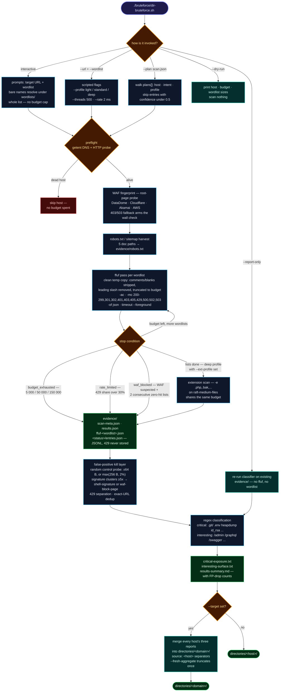

<h1 align="center">
  <br>
  
  <br>
  swarmrecon
  <br>
</h1>

<h4 align="center">Single-command web recon — CT · DNS · nmap · bruteforce · vhosts · crawling · filtering — in one 14-step script</h4>

<p align="center">
  
  
  
  
  
  /">
</p>

<p align="center">
  <b>swarmrecon</b> runs your entire recon playbook as one command —
  <code>./swarmrecon.sh -d target.com</code> — across <b>14 steps</b> and <b>20+ tools</b>,
  writing everything into a fixed <code>recon/&lt;domain&gt;/</code> tree:
  per-step raw output plus <b>final consumable files at the root</b>
  (<code>https-subs.txt</code> · <code>alive-domains.txt</code> · <code>merged-crawl.txt</code> ·
  <code>check/param-urls.txt</code> · <code>check/gf/gf-*.txt</code>)
  ready to feed into further testing or an engagement pipeline.
  <b>Fail-soft</b> — a missing tool skips its step with a warning, never aborts the run.
</p>

---

**Quick links:** [What is this?](#what-is-this) · [Quick Install](#quick-install) · [Usage](#usage) · [Manual](#manual) · [Manual: after Step 5](#port-discovery--service-brute-forcing-manual) · [Manual: Step 11](#directory-bruteforce-manual) · [Pipeline](#pipeline-14-steps) · [Source merge](#source-merge) · [Engagement Flow](#engagement-flow) · [Wordlists & patterns](#wordlists--patterns) · [Design notes](#design-notes)

---

> [!IMPORTANT]
> **Two workflows are manual — `swarmrecon.sh` does not run them:**
>
> - **Port Discovery & Service Brute-Forcing** — optional extension **after Step 5**
>   (`masscan` / `dnmasscan` → `nmap -sV` → `brutespray`).
>   **[Jump to the guide ↓](#port-discovery--service-brute-forcing-manual)**
> - **Step 11 — Directory Bruteforce** — the pipeline only records a *skip* row;
>   run `./bruteforce/dir-bruteforce.sh` yourself.
>   **[Jump to the guide ↓](#directory-bruteforce-manual)**

---

## What is this?

Recon normally means hand-running ~30 commands across CT logs, DNS, port scans,
bruteforce, crawling, and filtering — then manually sorting outputs into a folder
structure. `swarmrecon.sh` encodes that whole playbook:

- **One command** runs the full chain end to end.
- **Fail-soft by design** — a missing tool or failed step produces a warning and a
  `skip`/`fail` row in the final summary; the script exits `0` with a summary table
  (`✓` ok / `−` skipped / `✗` failed) instead of dying halfway. Most tool output
  is appended to `recon/<domain>/recon.log`; some tools write directly to their
  step files (see the per-step notes below).
- **Deterministic layout** — same folders, same filenames, every run. Steps that
  feed later stages clear their previous results before use, so a failed rerun
  cannot feed stale data downstream; a skipped step may still leave old raw
  evidence in its own folder.
- **Wordlists ship with the repo** — no separate download step.

---

## Quick Install

```bash
# 1. Clone & enter
git clone https://github.com/manojxshrestha/swarmrecon.git && cd swarmrecon

# 2. Install deps (wappalyzer + chromium, ctfr, unfurl, puredns + massdns,
#    subenum, PD httpx + dnsx, gau/uro/gf/katana/gospider/hakrawler, waymore,
#    GF patterns; installs uv when missing, then intel/OSINT tools —
#    msftrecon · Scopify · Spoofy · cloud_enum · theHarvester)
./install.sh
```

> **Idempotent — safe to re-run**: `install.sh` checks every component first and
> **skips what's already installed** (only missing things are installed); the GF
> sync likewise skips patterns already present and identical in `~/.gf`.
> It covers `wappalyzer`, Playwright Chromium, `ctfr` (→ `~/ctfr`, own venv),
> `puredns` + `massdns` (→ Go bin + `/usr/local/bin`), `subenum` (→ `~/subenum`,
> runs its own `install.sh`), **ProjectDiscovery `httpx` + `dnsx`**, the Step 13
> URL/crawl tools (`gau`, `uro`, `gf`, `katana`, `gospider`, `hakrawler`),
> `waymore` (→ `~/waymore/venv`), and **GF patterns**
> (`./gf-scripts/sync-gf-patterns.sh` copies `gf-patterns/*.json` → `~/.gf`,
> skips the manifest, prunes stale files).
> `uv` is installed automatically when missing (astral.sh); the step-3/4 intel
> tools then follow — `msftrecon`, `Scopify`, `Spoofy`, `cloud_enum`
> (→ `~/.local/bin/<repo>`, own venv) and `theHarvester` (→ `~/theHarvester`).
> **`httpx` collision handled:** the PD binary is built with
> `go install -v github.com/projectdiscovery/httpx/cmd/httpx@latest` into
> `~/.local/bin` (verified via `go version -m`), so it precedes — and shadows —
> the unrelated `python3-httpx` CLI that pip may have put in `/usr/bin`.
> Wordlists are bundled in `wordlists/`; everything else must already be on
> your `PATH` (see [Prerequisites](#prerequisites)).

---

## Prerequisites

External tools the script drives (install anything missing — `./install.sh`
handles its own set; any tool absent → that step skips itself with a hint and
the run continues):

| Category | Tools |
|----------|-------|
| Core | `bash` (5.x), `curl`, `jq`, `python3`, `git` |
| DNS | `dig`, `nslookup`, `whois` |
| Scanning / fuzzing | `nmap`, `ffuf` |
| ProjectDiscovery | `httpx`, `dnsx` — set up by `./install.sh`; the PD `httpx` is installed into `~/.local/bin` and verified with `go version -m` so it shadows any `python3-httpx` CLI |
| URL discovery | `gau`, `anew`, `uro`, `hakrawler`, `katana`, `gospider` — `gau`/`uro`/`hakrawler`/`katana`/`gospider` installed by `./install.sh`; `anew` must already be on `PATH` |
| Classification | `gf` — binary installed by `./install.sh`; patterns **bundled** in `gf-patterns/` (125 patterns, synced to `~/.gf` by `./install.sh`) |
| Crawling | `waymore` — `./install.sh` creates `~/waymore/venv`; manual alternative: `python3 -m venv ~/waymore/venv && ~/waymore/venv/bin/pip install waymore` (step 13 activates `~/waymore/venv`) |
| Intel / OSINT (steps 3-4) | `theHarvester`, `msftrecon`, `Scopify`, `Spoofy`, `cloud_enum` — set up by `./install.sh` (installs `uv` when missing) |

---

## Usage

```bash
./swarmrecon.sh -d target.com
```

| Flag | Meaning |
|------|---------|
| `-d, --domain <domain>` | target domain (required) |
| `-r, --resume` | resume at the first unfinished step |
| `-f, --from <n>` | start at step `n` (1–14) |
| `-h, --help` | usage |

Notes:

- Run it **from the repo directory** — outputs land in `recon/<domain>/` relative
  to your current working directory.
- Every run truncates and rewrites `recon/<domain>/recon.log` (including a
  resume — the new log covers only the steps that actually run).
- Colours auto-disable when output is piped or when `NO_COLOR` is set.
- **Manual after Step 5:** port discovery and service brute-forcing are not
  automated — see [Port Discovery & Service Brute-Forcing](#port-discovery--service-brute-forcing-manual).
- **Manual Step 11:** directory bruteforce is not automated — the pipeline
  records a *skip* row; run `./bruteforce/dir-bruteforce.sh` yourself
  (see [Directory Bruteforce](#directory-bruteforce-manual)).

### Resume / restart from a step

Stopped the run (Ctrl+C, terminal closed, reboot)? Don't redo Steps 1–12:

```bash
# continue at the first unfinished step (auto-detected)
./swarmrecon.sh -d target.com --resume

# or choose the step yourself
./swarmrecon.sh -d target.com --from 13
```

How `--resume` decides:

1. Every completed step appends `step|status|epoch` to
   `recon/<domain>/.swarmrecon-state` (latest line per step wins).
2. Resume starts at the first step whose status is not `ok`; a previously
   *skipped* step is retried (its missing tool may be installed now). At the
   start of every run the steps that are about to execute are marked
   `pending`, so an interruption always resumes at the right place even when
   old artifacts from a previous run are still on disk.
3. If there is no state file (a run from an older version), the same decision
   is made from the step artifacts — e.g. `merged-crawl.txt` missing means
   Step 13 did not finish.
4. If every step is already `ok`, it prints `nothing to do` and exits without
   running anything.

Steps before the start point are left untouched and appear in the summary as
`− not run — resumed at step N`. Step 11 is manual and always recorded as
`skip`.

`--from <n>` is an explicit override: it skips the detection and starts at `n`
(handy to re-run a single step, e.g. `--from 14`). It cannot be combined with
`--resume`.

> `--resume` assumes the earlier steps' outputs are still in
> `recon/<domain>/`. Starting at a step whose inputs are missing makes that
> step skip or fail — use a full run (no flags) in that case.

---

<a id="manual"></a>
## Manual

`swarmrecon.sh` runs steps 1–14 automatically, with **two deliberate manual
branches**. It never executes either one for you.

These are the only two parts of the playbook that are **not** run by
`swarmrecon.sh`. Both are deliberate manual decisions.

| When | Manual workflow | Command / chain | Output | Guide |
|---|---|---|---|---|
| **After Step 5** | **Port Discovery & Service Brute-Forcing** | `./portscan/portscan.sh` (auto-detect) · `./portscan/portscan.sh -d <domain>` (`dnmasscan` → `nmap -sV` → `brutespray`) | `recon/<domain>/05b-ports/` + `portscan/alive-domains.txt` | **[Open guide ↓](#port-discovery--service-brute-forcing-manual)** |
| **Step 11** | **Directory Bruteforce** | `./bruteforce/dir-bruteforce.sh` | `directories/<host>/` | **[Open guide ↓](#directory-bruteforce-manual)** |

---

## Pipeline (14 steps)

| # | Step | Tool(s) | Output |
|---|------|---------|--------|
| 1 | Technology discovery | `wappalyzer` (Playwright/Chromium) | `01-wappalyzer/technologies.json` |
| 2 | DNS + WHOIS | `dig`, `whois`, `nslookup` | `02-dns-whois/` — 13 files: A/AAAA/NS/MX/TXT/CAA/SOA/DMARC, Google/Cloudflare resolvers, nslookup, whois per domain + per resolved IP |
| 3 | Passive intel | `whois` + `msftrecon`, `Scopify`, `Spoofy`, `cloud_enum` (auto-venv) | `03-intel/` — `domain_info_general.txt`, `azure_tenant_domains.txt`, `scopify.txt`, `spoof.txt`, `cloud_enum.txt` |
| 4 | OSINT — subdomains + emails | `theHarvester` (2 source sets) | `04-osint/` — `theharvester_subdomains.json`, `theharvester_emails.json`, `subdomains.txt`, `emails.txt` (hosts forwarded by the Step 13/14 merge) |
| 5 | Port scan (single pass) | `nmap` | `05-nmap/` — `nmap-full.txt` (`-Pn --open -sV -T4 --top-ports 1000 --min-rate 500`) |
| 6 | Certificate Transparency | `ctfr` (auto-venv) + `httpx` | `06-ctfr/` — `ctfr-subdomains.txt`, `live-ctfr-subdomains.txt` (live-probed) |
| 7 | Subdomain enumeration | `subenum` + CT merge | root **`https-subs.txt`**, **`alive-domains.txt`** |
| 8 | DNS bruteforce | `puredns` + `massdns` | `08-puredns/puredns-subdomains.txt` (forwarded by the Step 13/14 merge) |
| 9 | Vhost fuzzing | `ffuf` (2 passes vs. dynamic baseline) | `09-vhost/` — `vhost-baseline.txt`, `vhost-mc-all.json`, `vhost-no403.json` (hits forwarded as `<label>.<domain>` candidates) |
| 10 | Zone transfer (AXFR) | `nslookup`, `dig axfr` per NS | `10-zone-transfer/` — `nslookup-NS.txt`, `axfr-<ns>.txt` |
| 11 | **DIRECTORY BRUTEFORCE — MANUAL** | *not run by pipeline* | run `./bruteforce/dir-bruteforce.sh` (interactive prompts: target URL → wordlist path) → `directories/<host>/` |
| 12 | Public files | `curl` | `12-robots-sitemap/` — `robots.txt`, `security.txt`, 7 sitemap path variants (sitemap URLs forwarded as crawl seeds) |
| 13 | Web crawling (10 sub-steps) | merge + `waymore`, `gau`, `uro`, `anew`, `hakrawler`, `katana`, `gospider`, `dnsx`, `httpx`, `extracturls.sh`, `filter.sh`, `gf` | root crawl files + `gooutput/` + `check/` (+ `check/gf/`); starts by merging Step 4/8/9/12 candidates into the root lists |
| 14 | High-value paths | `ffuf` (auto-calibrated) — sources: `https://<domain>` + each host in `alive-domains.txt` (including the merged Step 4/8/9/12 candidates) | `14-high-value/` — `high-value-results.json` (merged), `high-value-results.txt`, `high-value-<host>.json` |

> **Merge hand-off:** before Step 13 and again before Step 14, `merge/merge-sources.sh` folds the Step 4/8/9/12 candidates into `recon/<domain>/merge/merged-alive-domains.txt` and `merged-https-subs.txt`, appends them to the root `alive-domains.txt` / `https-subs.txt`, then deletes the merged files. See [Source merge for Steps 13/14](#source-merge).

> [!IMPORTANT]
> **Manual branches — the pipeline never runs these:**
>
> - **After Step 5 — [Port Discovery & Service Brute-Forcing](#port-discovery--service-brute-forcing-manual):**
>   `./portscan/portscan.sh -d <domain>` → `dnmasscan` → `nmap -sV` →
>   `brutespray`. This is an explicit credential-guessing decision.
> - **Step 11 — [Directory Bruteforce](#directory-bruteforce-manual):**
>   `./bruteforce/dir-bruteforce.sh`. `swarmrecon.sh` only records a *skip* row and prints
>   the pointer.

<a id="source-merge"></a>
### Source merge for Steps 13/14

Steps 4, 8, 9, and 12 produce candidates that used to stay inside their
numbered directories. `merge/merge-sources.sh` collects them into two
transient files under `recon/<domain>/merge/`:

| Merged file | Built from | Contents |
|---|---|---|
| `merged-alive-domains.txt` | `04-osint/subdomains.txt` · `08-puredns/puredns-subdomains.txt` · `09-vhost/*.json` · sitemap hostnames | bare in-scope hosts (`<label>.<domain>` for vhost hits) |
| `merged-https-subs.txt` | the same hosts + `12-robots-sitemap/sitemap-urls.txt` · `advertised-sitemaps.txt` | one `https://<host>` seed per merged host, plus sitemap URLs (their scheme is preserved) |

The merge is offline: it normalizes (lowercase, strips wildcards, ports,
`host:IP,...` annotations, and fragments), keeps only exact in-scope hosts
(apex or a real `.domain` boundary), rejects crawler-concatenation junk, and
dedupes. Every host in `merged-alive-domains.txt` also gets an `https://` seed
in `merged-https-subs.txt`, so OSINT/puredns hosts are not left uncrawled. It
does **not** probe the candidates — a merged host is a candidate, not a
verified live host.

Source extraction: `04-osint` keeps the host before any `:IP,...` annotation;
`08-puredns` is host-only; `09-vhost` reads ffuf JSON (`host`, falling back to
`input.FUZZ`); `12` takes only absolute `http(s)` URLs from `<loc>` and
`Sitemap:` lines. Everything else in those files (JSON metadata, status codes,
IPs, paths outside URLs) is discarded.

`swarmrecon.sh` then performs the append-and-delete flow at the start of both
Step 13 and Step 14 (commands shown from `recon/<domain>/`):

```bash
cat merge/merged-alive-domains.txt >> alive-domains.txt
rm  merge/merged-alive-domains.txt
cat merge/merged-https-subs.txt   >> https-subs.txt
rm  merge/merged-https-subs.txt
```

The implementation appends with `sort -u` (so the root lists stay deduped) and
regenerates the candidates before each of the two steps, which makes the flow
idempotent and rerun-safe. The `merge/` directory is removed once empty; the
final `alive-domains.txt` and `https-subs.txt` remain at the recon root.

Run it standalone when you want the two lists without starting a crawl:

```bash
./merge/merge-sources.sh -d example.com          # → recon/example.com/merge/
./merge/merge-sources.sh -d example.com -o recon/example.com
```

### Step 13 in detail

0. `merge/merge-sources.sh` → append `merged-alive-domains.txt` /
   `merged-https-subs.txt` to the root lists, then delete the merged files.
1. `cd ~/waymore && waymore -i <domain> -mode U -oU wayurls.txt` (venv activated, runs inside `~/waymore`, stale `wayurls.txt` removed first) → **moved** to root `wayurls.txt`
2. `echo <domain> | gau --threads 10 --subs | anew gauurls.txt` (no `anew` → plain `> gauurls.txt`) → root `gauurls.txt`
   `gau` reads `~/.gau.toml`; `./install.sh` creates it early, before the
   optional tool installs, when absent (20 threads, 5 retries,
   wayback/commoncrawl/otx/urlscan). If providers are unreachable or
   rate-limited, `gau` can still exit `0` with 0 URLs — run it with
   `--verbose` to see per-provider errors. To repair/create only the config
   without reinstalling anything: `./install.sh --gau-config-only`.
3. `cat wayurls.txt gauurls.txt | uro | sort -u > waygauurls.txt` (only the inputs that exist; no `uro` → `sort -u` alone) → root `waygauurls.txt`
4. `cat https-subs.txt | hakrawler -subs -u -d 3 > hakcrawlurls.txt` → root `hakcrawlurls.txt`
5. `cat https-subs.txt | katana -d 3 -jc -timeout 15 -c 20 | anew cleansubskatanaurls.txt` (no `anew` → plain `> cleansubskatanaurls.txt`) → root `cleansubskatanaurls.txt`
6. `gospider -S https-subs.txt -o gooutput/ -c 10 -d 3 -t 20` → `gooutput/`
7. `extracturls.sh -f gooutput/ -d <domain>` (requires `dnsx` + `httpx`) → writes into `gooutput/`, then `alivesubsurls.txt` is **moved** to root
8. `cat waygauurls.txt cleansubskatanaurls.txt hakcrawlurls.txt alivesubsurls.txt | uro > merged-crawl.txt` (missing inputs skipped with a warning; no `uro` → `sort -u`) → root **`merged-crawl.txt`**
9. `cd recon/<domain> && echo <domain> | ../../filter.sh` (liveness + param/API/IDOR classification; cwd must be the recon dir so its default input `merged-crawl.txt` resolves) → `check/`
10. `cd recon/<domain> && ../../gf-scripts/gf-extract.sh check/param-urls.txt check/gf` → `check/gf/gf-*.txt`

---

<a id="port-discovery--service-brute-forcing-manual"></a>
## Port Discovery & Service Brute-Forcing — MANUAL (after Step 5)

> [!IMPORTANT]
> **Not run by `swarmrecon.sh`.** This is an optional manual extension after
> Step 5. Run it yourself against an authorized target.

Run it with no arguments to auto-detect the newest
`recon/<domain>/alive-domains.txt` and copy it to
`portscan/alive-domains.txt`:

```bash
./portscan/portscan.sh
```

Or name the target explicitly:

```bash
./portscan/portscan.sh -d example.com
```

The wrapper runs `dnmasscan --top-ports 1000` → `nmap -Pn -sV` → optional
`brutespray`. It prompts for your sudo password before dnMasscan and asks again
before credential testing. Output goes to `recon/<domain>/05b-ports/`.

First-time setup (idempotent — verifies/installs `nmap`, `masscan`,
`dnmasscan`, `brutespray`, `dig`):

```bash
./portscan/install.sh
```

Common variants:

```bash
./portscan/portscan.sh -d example.com --dry-run      # print commands only
./portscan/portscan.sh -d example.com --no-brute     # inventory only
./portscan/portscan.sh -d example.com --yes          # authorized, no prompts
```

See **[portscan/README.md](portscan/README.md)** for the full guide: install,
flags, exact commands, output tree, and safety gates.

> This workflow uses `dnmasscan --top-ports 1000` against the merged host list.

<a id="directory-bruteforce-manual"></a>
## Directory Bruteforce — MANUAL (Step 11)

> [!IMPORTANT]
> **Not run by `swarmrecon.sh`.** The pipeline records a *skip* row for Step 11.
> Run `./bruteforce/dir-bruteforce.sh` yourself when you want path discovery.

Optional workflow that **step 11** hands off to — `swarmrecon.sh` never runs it,
it only records a *skip* row in the summary. `./bruteforce/dir-bruteforce.sh` is a
standalone ffuf driver: preflight → WAF fingerprint → robots harvest →
budgeted ffuf loop → false-positive kill layer → classified reports, all under
`directories/<host>/` at the repo root.



> **Not automated in `swarmrecon.sh`** — step 11 always records a *skip* row.
> When (and how hard) to brute-force stays an explicit, deliberate decision.

### 1. Three ways to run it

| Mode | Command | What happens |
|------|---------|--------------|
| Interactive | `./bruteforce/dir-bruteforce.sh` | prompts `Target URL:` → numbered wordlist menu (`Enter` = `common.txt`; number, bare name, or full path), then scans the **whole list — no budget cap** |
| Single host | `./bruteforce/dir-bruteforce.sh --url <url> --wordlist <path>` | scripted; `--wordlist` is repeatable and **required** — there are no built-in lists |
| Batch plan | `./bruteforce/dir-bruteforce.sh --plan <scan.json> --wordlist <path>` | walks `plans[]` (host · intent · profile · confidence) and skips entries with confidence < 0.5 |

```bash
./bruteforce/dir-bruteforce.sh
# Target URL: https://example.com
# Wordlist [common.txt] (number/name/path, 'l'=list): raft-medium-directories.txt
#   Enter = common.txt · number = menu entry · bare name = wordlists/ · or a full path
#
# Show the menu without starting a scan:
./bruteforce/dir-bruteforce.sh --list-wordlists
```

### 2. How a scan runs

1. **Pre-flight** — `getent` DNS check + one HTTP probe; NXDOMAIN or unreachable hosts are skipped **before any request budget is spent**.
2. **WAF fingerprint** — one root-page probe: body signatures for DataDome, Cloudflare, Akamai and AWS WAF, with a 403/503 status fallback. The verdict arms the WAF-wall stop condition.
3. **robots.txt / sitemap harvest** — cheap fetch of 5 doc paths into `evidence/robots.txt` before fuzzing starts.
4. **Budgeted ffuf loop** — one pass per wordlist:
   - a clean temp copy is built per list: comments/blanks stripped, leading `/` removed (no `//FUZZ`), truncated to the remaining budget;
   - `ffuf -u <host>/FUZZ -ac -mc 200-299,301,302,401,403,405,429,500,502,503 -of json` under `timeout --foreground`, with rate + thread flags;
   - every `429` is counted for the stop condition but never stored as a finding.
5. **Extension scan** — only with `--profile deep` + `--ext-profile php|java|dotnet|generic`: a second ffuf pass with `-e .php,.bak,…` against `raft-medium-files.txt`, sharing the same budget.
6. **Evidence write** — `scan-meta.json` (budget used, `stopped_reason`, WAF verdict), merged `results.json`, per-status `entries.json` (JSONL — one object per line).
7. **Report generation** — the false-positive kill layer below, then regex classification into critical / interesting reports.

### 3. Stop conditions & budgets

| Guard | Trigger | Effect |
|-------|---------|--------|
| Request budget | `light` 5 000 · `standard` 50 000 · `deep` 150 000 · interactive = full wordlist (uncapped) | loop stops → `stopped_reason: budget_exhausted` |
| Rate-limit brake | >30% of all responses are `429` | immediate stop → `rate_limited` |
| WAF wall | WAF suspected **and** 2+ consecutive wordlists return 0 hits with 0×429 (everything hitting one challenge page) | stop → `waf_blocked` |
| Per-ffuf timeout | `entries × 3 / req-per-sec + 300` seconds via `timeout --foreground` | a hung ffuf can never stall the run |
| Ctrl+C | INT → TERM → KILL escalation across the process group | clean teardown, exit 130 |
| Fresh-run hygiene | `--force` wipes evidence; `entries.json` reset before write; `rm -f` before each ffuf output | stale results can never pass as fresh |

### 4. False-positive detection & killing

Directory bruteforce is drowned in fake hits: SPA soft-shells answer **200 for
any path** (including `/.git/`), and WAFs answer one identical block page for
every flagged path. The report stage runs a kill layer with three mechanisms,
plus two upstream filters:

1. **Random control probe** — per host, the classifier fetches
   `<base>/fp-control-<random-hex>/`, a path that cannot exist. Any finding
   whose `[status, length]` matches the control within tolerance (±64 B for
   small pages, `max(256 B, 2%)` for larger ones) is dropped → `fp_dropped_control`.
2. **Identical-signature clustering** — findings are bucketed per host by
   `(status, words, lines, length)` (length bucketed per 100 KB above 50 KB,
   because nonces make big shells vary byte-to-byte). A signature seen **≥5×**
   is a canned response and is dropped, with a forensic split:
   - sensitive path (`.git/` `.env` `.svn/` `.aws/` `id_rsa` `web.config` …)
     **or** `403 + ≥50 KB` → counted as **waf-block-page** (one big block page
     served to every flagged path);
   - anything else → **shell-signature** (SPA catch-all).
3. **429 separation** — rate-limited responses are counted only for the stop
   condition and **never enter the result set** (429 ≠ finding).

Upstream, feeding the same goal:

- **ffuf `-ac` auto-calibration** — measures a random-path baseline and discards
  same-size soft-404 responses *before* they reach the evidence files.
- **Exact-URL dedup** — duplicates are dropped during classification.

What survives is classified by regex:

| Class | Example patterns |
|-------|------------------|
| **Critical** | `\.git/` `\.env` `heapdump` `dump.sql` `database.sql` `web.config` `id_rsa` `\.aws/credentials` `\.svn/` `phpinfo.php` |
| **Interesting** | `/admin` `/graphql` `/swagger` `/actuator` `/oauth/` `/login` `/wp-admin` `/api/` `/console` `\.well-known` `/signup` `/forgot-password` |

All drop counts land in `results-summary.md`:

```
- FP dropped (control-match):   N
- FP dropped (waf-block-page):  N
- FP dropped (shell-signature): N
```

### 5. Output layout

```
directories/
└── <host>/
    ├── evidence/
    │   ├── scan-meta.json          # run_id · budget · stopped_reason · WAF verdict
    │   ├── results.json            # merged hits (429s excluded)
    │   ├── robots.txt              # harvested doc paths
    │   ├── ffuf-<wordlist>.json    # raw ffuf output per wordlist
    │   └── <status>/entries.json   # JSONL per status code (200/ 403/ …)
    ├── critical-exposure.txt
    ├── interesting-surface.txt
    └── results-summary.md          # totals + FP-drop counts + findings
```

`--target <domain>` merges the three report files of every scanned host into
`directories/<domain>/` with `# source: <host>` separators; add
`--fresh-aggregate` to truncate that root once at the start of a batch.

### Flags

| Flag | Meaning |
|------|---------|
| `--wordlist <path>` | wordlist file — repeatable, **required** outside interactive mode (bare names resolve under `wordlists/`) |
| `--profile <name>` | `light` 5 000 / `standard` 50 000 / `deep` 150 000 request budget (interactive runs uncapped) |
| `--ext-profile <name>` | `php` `java` `dotnet` `generic` — extension list for the deep-profile second pass |
| `--threads <n>` | ffuf concurrency (default 500) |
| `--rate <ms>` | inter-request delay (default 2 ms ≈ 500 req/s) |
| `--target <domain>` | aggregate reports into `directories/<domain>/` |
| `--plan <file>` | batch mode: every host in a JSON scan plan |
| `--dry-run` | print host, budget, wordlist sizes and output path — scan nothing |
| `--force` | wipe existing evidence first |
| `--report-only` | re-run the classifier on existing evidence — no ffuf, no `--wordlist` needed |
| `--fresh-aggregate` | truncate the `--target` aggregate files once before a batch |

---

## Engagement Flow

Every `swarmrecon.sh` run walks the same 14-step pipeline into `recon/<domain>/`,
and every raw tool line lands in `recon.log`. The flow is fail-soft by design:
each step reports **ok / skip / fail** into the summary table instead of stopping
the run, so the script always finishes and exits `0`. Numbered dirs hold raw
per-step output; the root holds the final artifacts. After step 5, port
discovery → service brute-forcing exists only as a deliberate manual extension
(see [the guide](#port-discovery--service-brute-forcing-manual)); step 11
(directory bruteforce) is likewise never run — it always records a *skip* row
and hands off to `./bruteforce/dir-bruteforce.sh`
(see [Directory Bruteforce](#directory-bruteforce-manual)).

The diagram groups the pipeline into three phases — **discovery (1–5)**,
**surface (6–10)**, and **content/delivery (11–14)** — so the manual branches,
merge points, and final artifacts stay readable.

```mermaid
flowchart TD
    classDef entry fill:#1e1b4b,stroke:#818cf8,stroke-width:2px,color:#e0e7ff
    classDef phase fill:#0f172a,stroke:#38bdf8,stroke-width:1.5px,color:#e2e8f0
    classDef manual fill:#042f2e,stroke:#2dd4bf,stroke-width:1.5px,color:#ccfbf1
    classDef merge fill:#172554,stroke:#60a5fa,stroke-width:2px,color:#dbeafe
    classDef artifact fill:#052e16,stroke:#4ade80,stroke-width:1.5px,color:#dcfce7

    SETUP["ONE-TIME SETUP<br/>./install.sh · ./gf-scripts/sync-gf-patterns.sh"]:::manual --> RUN(["./swarmrecon.sh -d example.com"]):::entry

    subgraph P1["1–5 · DISCOVERY"]
        direction LR
        S1["1 · Wappalyzer<br/>tech fingerprint<br/>→ 01-wappalyzer/"]:::phase --> S2["2 · DNS + WHOIS<br/>dig · whois · nslookup<br/>→ 02-dns-whois/"]:::phase
        S2 --> S3["3 · Passive intel<br/>whois · msftrecon · Scopify<br/>Spoofy · cloud_enum<br/>→ 03-intel/"]:::phase
        S3 --> S4["4 · OSINT<br/>theHarvester: subs + emails<br/>→ 04-osint/"]:::phase
        S4 --> S5["5 · Nmap<br/>single-pass port scan<br/>→ 05-nmap/"]:::phase
    end

    subgraph P2["6–10 · SURFACE"]
        direction LR
        S6["6 · CT logs<br/>ctfr: crt.sh + liveness<br/>live CT feeds Step 7<br/>→ 06-ctfr/"]:::phase --> S7["7 · Subenum<br/>multi-source gather + resolve<br/>root: https-subs.txt + alive-domains.txt"]:::phase
        S7 --> S8["8 · DNS bruteforce<br/>puredns + massdns<br/>→ 08-puredns/"]:::phase
        S8 --> S9["9 · Vhost fuzz<br/>Host-header discovery<br/>→ 09-vhost/"]:::phase
        S9 --> S10["10 · Zone transfer<br/>AXFR per NS<br/>→ 10-zone-transfer/"]:::phase
    end

    subgraph P3["11–14 · CONTENT + DELIVERY"]
        direction LR
        S11["11 · Directory bruteforce<br/>MANUAL — pipeline skip<br/>./bruteforce/dir-bruteforce.sh<br/>→ directories/&lt;host&gt;/"]:::manual --> S12["12 · Robots / sitemap<br/>curl → &lt;loc&gt; + Sitemap:<br/>→ 12-robots-sitemap/"]:::phase
        S12 --> M13["MERGE 4/8/9/12<br/>writes merged-*.txt<br/>append → root lists<br/>delete merged"]:::merge
        M13 --> S13["13 · Web crawl<br/>waymore · gau · hakrawler<br/>katana · gospider<br/>filter.sh + gf-extract.sh<br/>7 crawl files · check/ · gooutput/"]:::phase
        S13 --> M14["MERGE AGAIN<br/>idempotent<br/>covers skipped 13"]:::merge
        M14 --> S14["14 · High-value<br/>ffuf secrets · admin · backups<br/>root + alive-domains.txt<br/>→ 14-high-value/"]:::phase
    end

    RUN --> S1
    S5 --> S6
    S5 -.-> MPORT["OPTIONAL MANUAL — after Step 5<br/>./portscan/portscan.sh -d &lt;domain&gt;<br/>dnmasscan → nmap -sV → brutespray<br/>authorization required"]:::manual
    S10 --> S11
    S14 --> DONE["DONE — root finals + summary<br/>https-subs.txt · alive-domains.txt · 7 crawl files<br/>ok / skip / fail per step · failures → recon.log · exit 0"]:::artifact

    style P1 fill:#0b1220,stroke:#334155,stroke-width:1.5px,color:#cbd5e1
    style P2 fill:#0b1220,stroke:#334155,stroke-width:1.5px,color:#cbd5e1
    style P3 fill:#0b1220,stroke:#334155,stroke-width:1.5px,color:#cbd5e1
    linkStyle default stroke:#e2e8f0,stroke-width:1.5px
```



**Key properties of this flow:**

- **Fail-soft is the contract.** A missing tool prints the exact install hint (`./install.sh` / `go install …`) and records a *skip*; a failed step records *fail* + points at `recon.log`; neither stops the run — the summary table always prints and the script exits `0`.
- **Root = final, numbered dirs = raw.** Only step 7's `https-subs.txt` + `alive-domains.txt` and step 13's seven crawl files are final; `01-…` through `14-high-value/` and `gooutput/` are raw material. `subdomains/` is step-7 staging only — step 7 `rmdir`s it at the end (when empty), so it never lingers. `merge/` is transient too: it exists only between the merge and the append-and-delete step.
- **No orphaned candidates.** Step 4/8/9/12 outputs are merged into the two root lists at the start of Steps 13 and 14. The merge is scope-filtered, deduped, and rerun-safe, so later steps see the full candidate set without duplicate entries.
- **Merge process is append-and-delete.** `merge/merge-sources.sh` writes `merge/merged-alive-domains.txt` + `merge/merged-https-subs.txt`; `_append_unique` appends each to its root list with `sort -u`, then deletes the merged source. Step 14 regenerates and re-appends the same candidates, which dedupes to a no-op.
- **Step 13 never dies wholesale.** Each crawl tool, `filter.sh`, and `gf-scripts/gf-extract.sh` runs as an independent sub-step — one missing tool skips its slice only. `check/` holds the filter classification (`crawledurls` · `param-urls` · `httpx-raw` · `api-candidates` · `idor-candidates` · `api-param-candidates` · `idor-param-candidates`) plus `gf/gf-*.txt` pattern classes; `gooutput/` holds gospider raw + extracturls intermediates.
- **The manual branch stays manual.** masscan/nmap/brutespray needs interactive `sudo` and an explicit credential-guessing decision, so it's a deliberate side path off step 5 — never automated in the script.
- **Step 11 stays manual too.** Directory bruteforce is outside the pipeline — the run finishes with a *skip* row and a pointer to `./bruteforce/dir-bruteforce.sh`, which prompts for URL + wordlist and writes `directories/<host>/`. Choosing when (and how hard) to brute-force stays an explicit decision.
- **Setup is one-time, not per-run.** `./install.sh` is idempotent and `./gf-scripts/sync-gf-patterns.sh` fills `~/.gf` once; re-runs skip what already exists.

---

## Helper scripts

Standalone helper scripts: Steps 13/14 invoke `merge/merge-sources.sh`, Step 13
invokes `extracturls.sh`, `filter.sh`, and `gf-scripts/gf-extract.sh` automatically,
`install.sh` runs `gf-scripts/sync-gf-patterns.sh`, while
`bruteforce/dir-bruteforce.sh` and `portscan/portscan.sh` run only when you
invoke them (steps 11 and the post-Step-5 port workflow are manual):

| Script | Usage | Notes |
|--------|-------|-------|
| `extracturls.sh` | `./extracturls.sh -f <gospider_folder> -d <domain>` | Extracts + liveness-probes subdomains from crawler output. Requires `dnsx` + `httpx`. |
| `filter.sh` | `echo <domain> \| ./filter.sh [input]` | Interactive domain prompt (fed via stdin). Defaults to `merged-crawl.txt` in CWD; writes 7 files to `check/` (6 classification + `httpx-raw`). Keeps WAF/403/401 alive, drops 404s/errors; strips fragments + tracking params; classifies API/IDOR candidates. |
| `gf-scripts/gf-extract.sh` | `./gf-scripts/gf-extract.sh [input_file] [out_dir]` | Defaults: `check/param-urls.txt` → `check/gf/`. `$1` must be a **file** (not a directory). Only patterns with hits produce files; patterns whose `_` → `-` sanitized names collide are skipped with a warning. |
| `merge/merge-sources.sh` | `./merge/merge-sources.sh -d <domain> [-o <outdir>]` | Builds `merge/merged-alive-domains.txt` + `merge/merged-https-subs.txt` from Step 4/8/9/12 outputs. Called automatically at the start of Steps 13 and 14; safe to run standalone. |
| `gf-scripts/sync-gf-patterns.sh` | `./gf-scripts/sync-gf-patterns.sh` | Copies `gf-patterns/*.json` → `~/.gf` (skips identical, index excluded, prunes **only this repo's** previously-synced files — ownership-aware for shared `~/.gf`). Called by `install.sh`; run standalone after editing patterns. |
| `bruteforce/dir-bruteforce.sh` | `./bruteforce/dir-bruteforce.sh` (interactive) · `./bruteforce/dir-bruteforce.sh --url <url> --wordlist <path>` | ffuf path discovery — **never auto-run** by the pipeline (step 11 = *skip*). Interactive mode shows a numbered wordlist menu (`Enter` = `common.txt`, or number/name/path); `--list-wordlists` prints it without scanning. Profiles `--profile light\|standard\|deep` + `--ext-profile`, plus `--plan <scan.json>`, `--dry-run`, `--force`, `--report-only`, `--target <domain>` (merges hosts under `directories/<domain>/`; `--fresh-aggregate` truncates it first). Output: `directories/<host>/` (evidence + reports). |
| `portscan/install.sh` | `./portscan/install.sh` | Idempotent setup for the manual port workflow: verifies/installs `nmap`, `masscan`, `dnmasscan` (→ repo root), `brutespray` (→ `~/.local/bin`), and `dig`. Safe to re-run. |
| `portscan/portscan.sh` | `./portscan/portscan.sh` · `./portscan/portscan.sh -d <domain>` · `./portscan/portscan.sh -f <alive-domains.txt>` | Manual post-Step-5 workflow: `dnmasscan --top-ports 1000` → `nmap -Pn -sV` → optional `brutespray`. No-arg mode auto-detects the newest `recon/*/alive-domains.txt` and copies it to `portscan/alive-domains.txt`; sudo prompts for dnMasscan. Two confirmations (scan + credential testing); `--no-brute`, `--yes`, `--dry-run`, `--max-rate`, `--out`. Output: `recon/<domain>/05b-ports/`. See [`portscan/README.md`](portscan/README.md). |

---

## Wordlists & patterns

| File | Used by |
|------|---------|
| `subdomains-top1million-20000.txt` | step 8 — puredns bruteforce |
| `resolvers.txt` | step 8 — puredns resolvers |
| `common.txt` | step 9 — vhost fuzzing |
| `raft-medium-directories.txt` · `raft-medium-files.txt` · `big.txt` … (any file you choose) | step 11 (manual) — `./bruteforce/dir-bruteforce.sh` takes a bare name (resolved under `wordlists/`) at the `Wordlist path:` prompt or via `--wordlist <path>`; no built-in default |
| `high-value-paths.txt` | step 14 — secrets/disclosure/juicy files (`#`-marked sections are stripped at runtime), fuzzed against root + `alive-domains.txt` hosts |

### `gf-patterns/` (127 files)

Git-tracked source of truth for `gf(1)` patterns (125 real patterns +
`category-index.json` index + this README = 127 files). `gf` itself only
reads `~/.gf`, so:

- `./install.sh` → runs `./gf-scripts/sync-gf-patterns.sh`: **copies missing/changed
  patterns** into `~/.gf/` (identical files are skipped untouched — safe to
  re-run), skips `category-index.json` (index), and prunes **only files this
  repo previously synced** (tracked in `~/.gf/.swarmrecon-manifest`) that are
  no longer shipped. `~/.gf` is shared with openswarm — its patterns
  (`clickjacking`, `soap`, …) and user files are never touched. Repo stays
  the source of truth.
- Rerun standalone anytime: `./gf-scripts/sync-gf-patterns.sh` then `gf -list` to verify.

---

## Design notes

- **Fail-soft**: guards check every tool before running; results land in the summary
  table instead of exiting. The script exits `0` after printing it regardless of
  individual step results.
- **Fresh-run hygiene**: by the time a step's tools run it has cleared or
  truncated every file it owns (up-front `rm` / `: >`, or write-time `>`), so a
  failed run can never pass off stale results as new. Outputs that feed later
  steps (ctfr, subenum, crawl + merged files) are cleared *before their guards*,
  so even a skipped re-run can't leak old data into a later merge.
- **Resumable**: each step records `step|status|epoch` in
  `recon/<domain>/.swarmrecon-state` once it finishes. `--resume` reads the
  latest status per step and starts at the first one that is not `ok`
  (falling back to artifact detection when the state file is absent). Earlier
  steps are not re-run and are reported as skipped; the summary still lists all
  14 rows. A fresh run (no flags) truncates the state file.
- **Exit-code semantics**: steps built from informational commands (DNS queries
  that legitimately return NXDOMAIN, `curl` of possibly-absent files) are judged by
  *output existence*, not raw exit codes — that's why some blocks are written as
  `{ cmd1; cmd2; }` rather than `&&` chains.
- **No runtime installs**: `swarmrecon.sh` never installs anything — missing tools
  are reported with the exact command needed to install them.
- **Idempotent installer**: `install.sh` checks every component first and skips
  what's already installed (markers for ctfr/subenum; `command -v` for tools;
  `go version -m` for the PD `httpx` build); the GF sync copies only
  missing/changed patterns and prunes stale ones — safe to re-run any time.
  It installs `uv` itself when missing, and the PD `httpx` is built with
  `go install -v github.com/projectdiscovery/httpx/cmd/httpx@latest` into
  `~/.local/bin` so it wins over a pip-installed `python3-httpx`.
