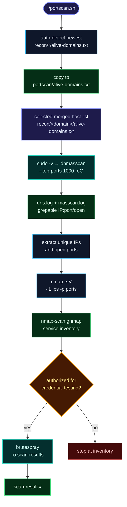

# Port Discovery & Service Brute-Forcing — MANUAL

> [!IMPORTANT]
> **Not run by `swarmrecon.sh`.** This is the manual extension after Step 5.
> Only run `brutespray` against systems you own or have **explicit written
> authorization** to test.

`./portscan/portscan.sh` wraps the three manual stages:

1. **dnMasscan** — resolve the final merged host list and find open ports.
2. **nmap `-sV`** — identify the service behind every discovered port.
3. **brutespray** — test default/custom credentials, after a second confirmation.



---

## 1. Input: use the final merged list

Use the root file created by the pipeline:

```text
recon/<domain>/alive-domains.txt
```

The Step 13/14 merge updates this file with Step 4/8/9/12 candidates. For the
most complete run, execute the pipeline first, then run this manual workflow.

You can also point at another file:

```bash
./portscan/portscan.sh -f /path/to/alive-domains.txt
```

Do not pass the raw step-7 staging list or an unmerged candidate file unless
that is deliberately what you want to scan.

## 2. Quick start

Install/verify the dependencies once (idempotent — existing tools are skipped):

```bash
./portscan/install.sh
```

Then run the workflow with no arguments to auto-detect the newest merged list:

```bash
./portscan/portscan.sh
```

If more than one `recon/*/alive-domains.txt` exists, it lists them and lets you
choose (press `Enter` for the newest). The selected file is copied to
`portscan/alive-domains.txt` as the manual-run snapshot (overwritten on each
run); the scan itself reads the original recon file.

The first confirmation defaults to yes (`[Y/n]`, so `Enter` continues). The
`brutespray` confirmation still requires typing `yes` unless you passed
`--yes`.

Or name the target explicitly:

```bash
./portscan/portscan.sh -d example.com
```

The script:

1. shows the target count and output path;
2. asks for confirmation before starting dnMasscan;
3. asks for your sudo password before dnMasscan runs;
4. asks again before `brutespray` (credential testing);
5. writes all evidence under `recon/<domain>/05b-ports/`.

Useful variants:

```bash
# Show every command without running anything
./portscan/portscan.sh -d example.com --dry-run

# Port + service inventory only — never run brutespray
./portscan/portscan.sh -d example.com --no-brute

# Authorized non-interactive run (skips both prompts)
./portscan/portscan.sh -d example.com --yes

# Custom output directory and port count
./portscan/portscan.sh -d example.com -o /tmp/example-ports --top-ports 2000
```

## 3. Requirements

| Tool | Purpose | Install |
|---|---|---|
| `nmap` | Service/version detection | `./portscan/install.sh` (falls back to `sudo apt-get install -y nmap`) |
| `masscan` | Fast port discovery (used by dnmasscan) | `./portscan/install.sh` (apt, else builds from source with `make && sudo make install`) |
| `dnmasscan` | Resolve domains, then run masscan | `./portscan/install.sh` → repo root `./dnmasscan`; manual alternative: <https://github.com/rastating/dnmasscan> |
| `brutespray` | Credential testing from nmap grepable output | `./portscan/install.sh` → `~/.local/bin/brutespray`; manual: `go install github.com/x90skysn3k/brutespray/v2@latest` |
| `dig` | DNS resolution inside dnmasscan | `./portscan/install.sh` (falls back to `sudo apt-get install -y dnsutils`) |

`./portscan/install.sh` is idempotent: every tool is checked first, only
missing pieces are installed, and anything it cannot install prints the exact
manual command (the script exits `1` if a component is still missing).

`nmap`, `masscan` and `dig` need root. The installer asks for your sudo
password when a privileged step is actually required — the same `sudo -v` flow
`portscan.sh` uses — rather than assuming passwordless sudo. `masscan` is
installed via apt when available; otherwise the script installs the build
dependencies (`git make gcc libpcap-dev`), clones
<https://github.com/robertdavidgraham/masscan>, then runs
`make && sudo make install`.

`dnmasscan` lookup order:

1. `--dnmasscan <path>`
2. `./dnmasscan`
3. `./tools/dnmasscan`
4. `dnmasscan` in `PATH`

## 4. What the script runs

### Stage 1 — dnMasscan

```bash
sudo ./dnmasscan recon/<domain>/alive-domains.txt \
  recon/<domain>/05b-ports/dns.log \
  --top-ports 1000 \
  -oG recon/<domain>/05b-ports/masscan.log
```

This is the **`--top-ports 1000`** workflow. `dnmasscan` needs root, so the
script runs `sudo -v` first and prompts for your password in the terminal; the
actual dnMasscan command then uses the cached sudo timestamp.

Adjust the port count with `--top-ports <n>`. Add `--max-rate <n>` if you need
to slow the scan down.

### Stage 2 — service scanning

The script extracts unique IPs and open ports, then runs:

```bash
nmap -Pn -sV \
  -iL recon/<domain>/05b-ports/ips.txt \
  -p "$(cat recon/<domain>/05b-ports/ports.txt)" \
  -oG recon/<domain>/05b-ports/nmap-scan.gnmap
```

`-Pn` is deliberate: masscan already proved those ports are open, so nmap must
not drop a host whose ICMP echo is filtered (the default ping discovery would
mark it down and skip `-sV`).

The equivalent inline form is:

```bash
nmap -Pn -sV \
  -iL <(grep -oP 'Host: \K[0-9.]+' masscan.log | sort -u) \
  -p"$(grep -oP '\d+(?=/open)' masscan.log | sort -u | paste -sd,)" \
  -oG nmap-scan.gnmap
```

The script writes `ips.txt` and `ports.txt` first so the nmap command is easy to
inspect and rerun.

### Stage 3 — brutespray

```bash
brutespray \
  -f recon/<domain>/05b-ports/nmap-scan.gnmap \
  -o recon/<domain>/05b-ports/scan-results
```

This is the credential-testing stage. It only runs after the second prompt, or
with `--yes` on an explicitly authorized run. Use `--no-brute` to keep the run
strictly at port/service inventory.

## 5. Output

```text
recon/<domain>/05b-ports/
  dns.log
  masscan.log
  ips.txt
  ports.txt
  nmap-scan.gnmap
  scan-results/            # only when brutespray runs

portscan/alive-domains.txt # snapshot of the selected merged input
```

The output directory is separate from the numbered pipeline steps;
`swarmrecon.sh` does not read it and does not add a summary row for it. The
input snapshot is target data, so it is covered by `.gitignore`.

## 6. Flags

| Flag | Meaning |
|---|---|
| `-d, --domain <domain>` | Use `recon/<domain>/alive-domains.txt` |
| `-f, --domains-file <file>` | Use an explicit merged domains file |
| `-o, --out <dir>` | Output directory (default: `recon/<domain>/05b-ports`) |
| `--top-ports <n>` | dnMasscan `--top-ports` value (default `1000`) |
| `--max-rate <n>` | Optional dnMasscan `--max-rate` |
| `--dnmasscan <path>` | dnMasscan script path |
| `--nmap <path>` | nmap binary path |
| `--brutespray <path>` | brutespray binary path |
| `--no-brute` | Stop after nmap; never run credential testing |
| `--yes` | Skip both confirmation prompts (authorized runs only); sudo still asks for your password |
| `--dry-run` | Print commands; execute nothing |
| `--no-sudo` | Do not prefix dnMasscan with `sudo` |
| `-h, --help` | Show help |

## 7. Safety and scope

- **Authorization first.** `brutespray` can lock accounts and trigger alerts.
  Use it only inside the agreed scope and rules of engagement.
- **Review the target count.** The script prints the number of domains from
  `alive-domains.txt` before scanning.
- **Resolve before scanning.** dnMasscan resolves the merged host list; verify
  DNS did not expand scope unexpectedly.
- **Rate-limit if needed.** Use `--max-rate` for fragile networks.
- **Stop at inventory when unsure.** `--no-brute` gives you ports and services
  without credential testing.

## 8. Troubleshooting

| Symptom | Fix |
|---|---|
| `dnmasscan not found` | Put it at `./dnmasscan`, `./tools/dnmasscan`, or pass `--dnmasscan` |
| `domains file not found` | Run the pipeline first; expected file is `recon/<domain>/alive-domains.txt` |
| `No open ports found` | Check the target list and dnMasscan output; nothing was open or the scan was filtered |
| `nmap produced no grepable output` | Check `masscan.log` and run with `--dry-run` to inspect the exact command |
| `brutespray not found` | Install it or use `--no-brute` for inventory only |
| `sudo: a terminal is required` | Run from an interactive terminal; the script uses `sudo -v` so the password prompt can appear |

Back to the main guide: [`../README.md`](../README.md).
